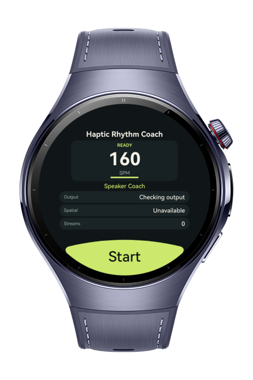

> **Note:** To access all shared projects, get information about environment setup, and view other guides, please visit [Explore-In-HMOS Index](https://github.com/Explore-In-HMOS/hmos-index).

# How to Build Haptic Coach
This project demonstrates how to build a compact rhythm-coaching experience for HarmonyOS wearable devices. The sample combines audio and haptic playback, output-device routing, spatial-audio status checks, and a watch-native ArkUI interface to guide a 160 SPM cadence session.

# Preview
<div>
  
</div>

# Use Cases

- **RhythmCoachAudioService**: A service class that owns cadence cue registration, playback, routing status, spatial-audio status, and cleanup.
  - **Audio-haptic source registration**: Loads `cadence_beat.wav` and `cadence_beat.json` from rawfile resources and registers them as a synchronized audio-haptic cue.
  - **Fast-latency cadence playback**: Configures music stream usage and fast audio latency mode before creating an `AudioHapticPlayer`.
  - **Haptic-only fallback**: Retries playback with muted audio if full audio-haptic playback cannot start, keeping the watch vibration cue available.
  - **Output routing awareness**: Reads the preferred renderer output to distinguish watch speaker, Bluetooth earbuds, wired audio, USB audio, and unavailable output states.
  - **Spatial-audio awareness**: Queries whether spatialization is supported and enabled for the current output device.
  - **Live status monitoring**: Subscribes to output-device, preferred-output, renderer, spatialization, and cue end events so the UI can refresh automatically.
- **Index**: Entry page that presents the rhythm coach in a round-watch-friendly layout.
  - **Setup state**: Shows the fixed 160 SPM target, current coach mode, preferred output, spatial state, and active renderer count.
  - **Running state**: Shows a live beat counter, cue status, coach mode, and audio/haptic mute state.
  - **ArcButton controls**: Uses a bottom-edge `ArcButton` for Start and Stop actions that match wearable interaction patterns.
  - **Lifecycle cleanup**: Stops timers, unsubscribes listeners, releases the player, and unregisters the source when the page disappears.

@kit.AudioKit
@kit.ArkUI
@kit.AbilityKit
@kit.PerformanceAnalysisKit

# Tech Stack

- **Languages**: ArkTS
- **Frameworks**: HarmonyOS SDK 6.0.1(21)
- **Tools**: DevEco Studio, Hvigor
- **Libraries**: @kit.AudioKit, @kit.ArkUI, @kit.AbilityKit, @kit.BasicServicesKit, @kit.PerformanceAnalysisKit

# Directory Structure
   ```
entry/src/main/
|---ets
|---|---pages
|---|---|---Index
|---|---services
|---|---|---RhythmCoachAudioService
|---|---entryability
|---|---|---EntryAbility
|---|---entrybackupability
|---|---|---EntryBackupAbility
|---resources
|---|---rawfile
|---|---|---cadence_beat.wav
|---|---|---cadence_beat.json
|---|---base
|---|---|---element
|---|---|---media
|---|---|---profile
   ```

# Constraints and Restrictions
## Supported Devices
- Huawei Watch 5
- Wearable devices that support HarmonyOS SDK 6.0.1(21), audio-haptic playback, and the `ohos.permission.VIBRATE` permission

# License
**How To Build Haptic Coach** is distributed under the terms of the MIT License
See the [LICENSE](./LICENSE) for more information.
